  

  <b>Desenvolvedor Full-Stack com Direção Visual</b> 
  Salvador, BA · remoto · Ciência da Computação na UNIFACS

  
  
  
  

---

Transformo problemas de negócio em produtos digitais que unem engenharia e direção visual: experiências web e mobile, painéis orientados por dados e automações com IA.

Meu jeito de trabalhar: **o que dá para decidir vira regra explícita e testada, e a IA fica só com a linguagem.** Preço, permissão e pagamento não dependem de prompt; dependem de código, banco e teste.

## O que eu construo

| | |
|---|---|
| **Interfaces digitais** | Sites e apps em que identidade visual, navegação e desempenho trabalham juntos. Componentes reutilizáveis, responsividade e acessibilidade. |
| **Sistemas conectados** | Produtos internos com fluxos, permissões e dados. Modelagem, RLS, APIs e integrações. |
| **Dados que orientam** | Diagnósticos, painéis e relatórios que viram decisão, com regras explícitas e IA onde agrega. |
| **Automação com contexto** | Fluxos que conectam WhatsApp, APIs e equipes, com memória, validação, CRM e passagem para atendimento humano. |

## Projetos em destaque

- **Katia · agente comercial com IA** — SDR para WhatsApp em serviço Node próprio: qualificação de leads, memória por conversa, áudio e imagem, integração com CRM e travas determinísticas para preço, link e pagamento.
- **Vazk Hub · operação, CRM & BI** — sistema interno em produção com 13 painéis e 9 serviços Node sobre PostgreSQL + PostgREST na AWS. Permissão decidida no banco (RPC + RLS), 110 migrações, 173 arquivos de teste e deploy conferido por sha256.
- **[VoltSSA · mapa inteligente de recarga](https://voltssa.vercel.app/)** — mapa 3D dos eletropostos de Salvador com custo real minuto a minuto, rota que considera o relevo, fila com mutex e antifraude por geolocalização. Roda inteiro no navegador, com 60+ testes de regras puras.
- **[Contágio Experience](https://contagioexperience.grupovazk.com.br/)** — ecossistema para evento empresarial: landing em WebGL, diagnóstico recalculado no servidor, ingressos, relatório em PDF e e-mail.
- **Vazk Club** — app mobile de conexões e negócios entre membros, com QR Code, gamificação e sincronização em tempo real (React Native + Supabase).
- **Dozer** e **Escada da IA** — diagnósticos ao vivo que combinam motor de regras e IA limitada por regras, com fila offline, painel de turma e PDF.

Mais casos, laboratório e portfólios de clientes em **[fabricio-seven.vercel.app](https://fabricio-seven.vercel.app/)**.

## Stack

**Frontend** 

**Mobile** 

**Backend & dados** 

**IA & automação** 

## Como eu trabalho

1. **Briefing** — quem usa, em que situação e o que não pode falhar.
2. **Regras** — decisão vira regra explícita; IA só onde agrega, com fallback local.
3. **Construção** — o caminho inteiro primeiro, de ponta a ponta.
4. **Testes** — regras puras testadas sem rede, sem banco e sem modelo.
5. **Publicação** — verificação automática antes de ir ao ar e conferência do que o site realmente serve depois.

  🇧🇷 Português (nativo) · 🇺🇸 Inglês (básico) · 🇪🇸 Espanhol (em andamento) 
  <b>Aberto a novos projetos e oportunidades.</b>

